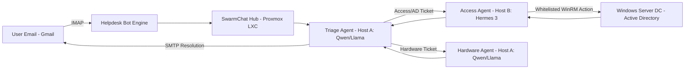

# Autonomous IT Helpdesk Swarm (Local AI + Active Directory)

A fully self-hosted, zero-subscription, multi-agent IT Helpdesk automation system. It ingests support tickets via email, routes them through specialized local LLM agents over **SwarmChat**, executes secure **Active Directory** operations via WinRM, and sends automated resolution emails back to the user.

## Architecture & Load Balancing

To avoid model-swapping bottlenecks on local hardware, LLM workloads are distributed across two separate Ollama hosts:



## Key Features

* **100% Local & Private:** Powered by local Ollama instances (`Qwen 2.5 Coder`, `Hermes 3`, `Llama 3`) and self-hosted `SwarmChat`. No cloud AI APIs or per-token costs.
* **Security First (Whitelisted AD Actions):** LLMs are never given raw PowerShell execution rights. The Access Agent outputs a structured intent (`ACTION: UNLOCK_USER | USER: <username>`), which is strictly regex-validated by Python before triggering predefined, safe Active Directory cmdlets over WinRM (NTLM).
* **Real-Time Observability:** All inter-agent communication, triage decisions, and AD execution logs are streamed live to the `#helpdesk` channel in SwarmChat.
* **End-to-End Email Loop:** Monitors unread emails with `TICKET` in the subject line and automatically replies with a user-friendly resolution summary.

## Prerequisites

* **SwarmChat Server** running on Linux / Proxmox LXC.
* **Ollama** running on one or more local hosts.
* **Windows Server Domain Controller** with WinRM enabled (`Enable-PSRemoting -Force`) and port `5985` accessible from the bot host.
* **Gmail Account** with an App Password enabled (for IMAP/SMTP).

## Quick Start

1. **Install dependencies:**

```bash
pip install -r requirements.txt
```

2. **Create SwarmChat agents & channel:**
   Create 4 agents (`client`, `triyaj`, `erisim`, `donanim`) using `swarmchat admin add` and join them to a public `#helpdesk` channel.

3. **Configure environment variables:**

```bash
cp .env.example .env
chmod 600 .env
nano .env
```

   Fill in your SwarmChat tokens, Ollama URLs, DC credentials, and Gmail App Password.

4. **Run the automation engine:**

```bash
python3 helpdesk_bot.py
```

## Live Demo

*

*

## Built With

* [SwarmChat](https://github.com/swarmchat) — Multi-agent communication hub
* [Ollama](https://ollama.com/) — Local LLM runtime
* [pywinrm](https://github.com/diyan/pywinrm) — Windows Remote Management for Python

## License

This project is licensed under the **GNU AGPLv3** — see the [LICENSE](LICENSE) file for details.
